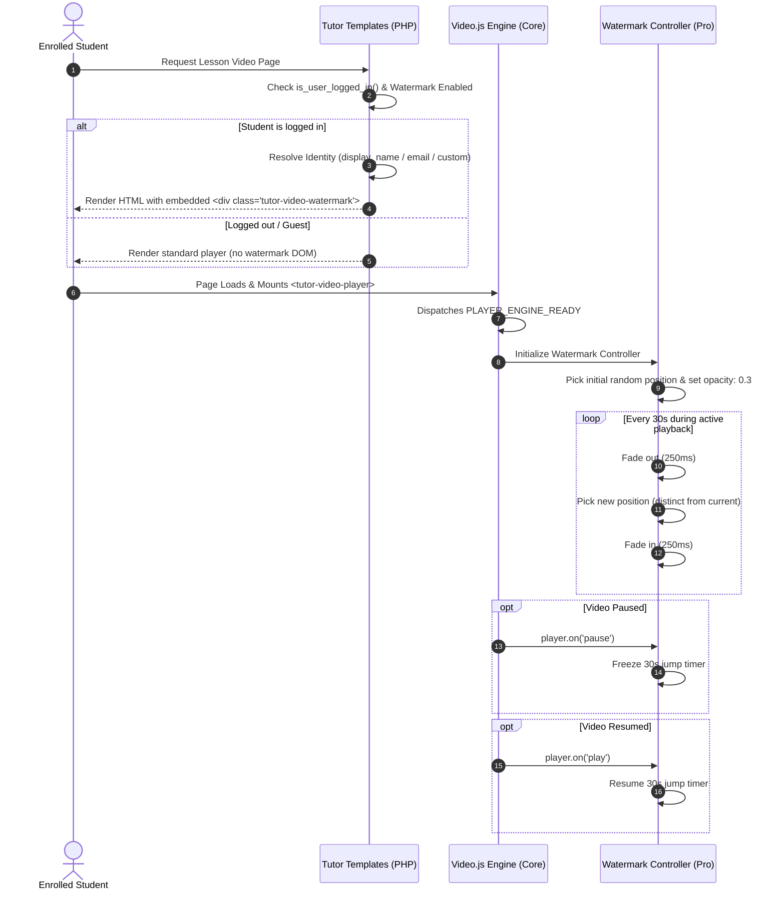

# Dynamic Video Watermark — Architecture & Technical Specification

> **Status:** Approved / Ready for Implementation  
> **Target Scope:** Tutor Pro (`tutor-pro`) with integration hooks in Tutor Core (`tutor`)  
> **Audience:** Core LMS Engineering Team, Security & Privacy Compliance  

---

## 1. Executive Summary & Threat Model

The **Dynamic Video Watermark** is a content-protection feature designed for **casual screen-recording deterrence and forensic tracing**.

### Threat Model & Boundaries
- **Primary Goal:** Deter students and casual users from recording course videos with software tools (OBS, QuickTime, browser screen recorders) by dynamically stamping viewer identity over playback. If unauthorized recordings leak, forensic examination of the video surface identifies the leaking account.
- **Explicit Non-Goal:** Active client-side anti-tampering against hostile reverse engineers. Client-side code running in a browser environment with GPU rendering cannot fundamentally prevent a motivated developer from inspecting the DOM or intercepting network streams. Trying to defeat DevTools via obfuscation arms races adds extreme technical debt for trivial security gains.
- **Focus:** High visual polish, non-intrusive learner experience (low cognitive distraction), resilient positioning across small and fullscreen modes, zero player layout breakage, and provider-agnostic operation.

---

## 2. Key Requirements & Settled Decisions

| Dimension | Specification | Rationale |
|---|---|---|
| **Ecosystem Location** | Tutor Pro only (`tutor-pro`) | Premium content-protection feature; core exposes extension points. |
| **Viewer Identity** | Default: `display_name`<br>Opt-in: `user_email`<br>Override: Custom text | GDPR pseudonymous by default; full email opt-in with compliance guidance. |
| **Visitor Handling** | No watermark for logged-out / guest users | Zero tracing value for unauthenticated traffic; prevents visual clutter. |
| **Providers Supported** | YouTube, Vimeo, HTML5, External, Raw Iframe/Shortcode | Full coverage across all course delivery channels. |
| **Motion Pattern** | 8 discrete positions (4 corners + 4 edge midpoints) | Eliminates predictable 4-corner crop zones without constant eye strain. |
| **Jump Interval** | 30 seconds default | Balanced anti-crop interval with minimal learner distraction. |
| **Motion Transition** | 250ms cross-fade (fade out $\to$ reposition $\to$ fade in) | Avoids jarring visual teleportation while maintaining clean UI aesthetics. |
| **Playback Sync** | Pauses timer when video is paused; resumes on play | Prevents distracting jumps while students read frozen slides. |
| **DOM Injection** | Pure PHP template injection | Eliminates flash of unwatermarked video during player JS boot. |
| **Interactivity** | `pointer-events: none`, `user-select: none` | Watermark never blocks clicks to video controls; non-highlightable text. |
| **Stacking Layer** | Above video surface, below control bar | Controls stay 100% clickable and readable. |
| **Typography & Sizing** | Responsive `clamp(12px, 1.4vw, 20px)` | Automatically scales proportionally between mobile, desktop, and 4K fullscreen. |
| **Configuration** | Code constants / defaults in v1 | Immediate zero-friction rollout; settings UI can be layered in v1.1. |

---

## 3. Architecture & DOM Hierarchy

### Light DOM Integration Strategy
The Video.js engine uses `<tutor-video-player>` as the custom element host. Player controls live inside the `<video-skin>` shadow DOM. Placing the watermark element in the **Light DOM** of `<tutor-video-player>` provides two critical advantages:
1. **Inherits Fullscreen Automatically:** `<tutor-video-player>` is the fullscreen container (`fullscreenElement`). Any light DOM child inside it stays visible and correctly positioned when entering/exiting fullscreen.
2. **Never Clashes with Shadow Controls:** The watermark sits in the light DOM between the video surface and shadow controls.

```
┌──────────────────────────────────────────────────────────────┐
│  <tutor-video-player> / .tutor-video-player                  │
│  (Position: relative, overflow: hidden, aspect-ratio: 16/9)  │
│                                                              │
│  ├── <video-skin> (Shadow DOM)                               │
│  │   ├── <media-container>                                  │
│  │   │   ├── <slot> (hosts media: <video>, <youtube-video>)  │
│  │   │   └── <media-controls> (Z-Index: 10)                 │
│  │                                                           │
│  └── <div class="tutor-video-watermark is-active" ...>       │
│      (Position: absolute, Z-Index: 5, pointer-events: none)  │
│      <span>Jane Doe</span>                                   │
└──────────────────────────────────────────────────────────────┘
```

For **raw iframe/shortcode embeds** where `<tutor-video-player>` custom element is not used, the outer `.tutor-video-player` container wrapper provides identical `relative` positioning and houses the same `.tutor-video-watermark` element.

---

## 4. The 8 Discrete Positions

The watermark positions are distributed around the periphery with a safe inset (padding: `1.25rem` / `20px`) to prevent interference with player edges, control bars, or mobile safe areas:

```
┌──────────────────────────────────────────────────────────────┐
│ [top-left]                 [top-center]          [top-right] │
│                                                              │
│                                                              │
│ [middle-left]                                 [middle-right] │
│                                                              │
│                                                              │
│ [bottom-left]            [bottom-center]      [bottom-right] │
│ (clear of scrub bar)   (clear of scrub bar)                  │
└──────────────────────────────────────────────────────────────┘
```

### Position State Table
| Class Name | CSS Alignment | Screen Area |
|---|---|---|
| `pos-top-left` | `top: 1.25rem; left: 1.25rem;` | Top Left |
| `pos-top-center` | `top: 1.25rem; left: 50%; transform: translateX(-50%);` | Top Center |
| `pos-top-right` | `top: 1.25rem; right: 1.25rem;` | Top Right |
| `pos-middle-left` | `top: 50%; left: 1.25rem; transform: translateY(-50%);` | Center Left |
| `pos-middle-right` | `top: 50%; right: 1.25rem; transform: translateY(-50%);` | Center Right |
| `pos-bottom-left` | `bottom: 4rem; left: 1.25rem;` | Bottom Left (above control bar) |
| `pos-bottom-center` | `bottom: 4rem; left: 50%; transform: translateX(-50%);` | Bottom Center (above control bar) |
| `pos-bottom-right` | `bottom: 4rem; right: 1.25rem;` | Bottom Right (above control bar) |

*Note: Bottom positions use `bottom: 4rem` to remain clear of the player control bar.*

---

## 5. Sequence & Data Flow



---

## 6. GDPR & Privacy Compliance Specification

1. **Lawful Basis for Processing (GDPR Art. 6(1)(f)):**
   - The processing of student identity for watermarking falls under the publisher's **Legitimate Interest** in preventing intellectual property theft and unauthorized redistribution of proprietary educational materials.
2. **Data Minimization (Default):**
   - The system defaults strictly to `display_name` (e.g. "Jane Doe"), which is pseudonymous within the context of the course platform.
3. **Email Address Opt-In Requirements:**
   - Under GDPR, email addresses constitute direct Personally Identifiable Information (PII).
   - If the administrator configures the watermark to display email addresses, platform documentation must recommend updating terms of service and course enrollment disclosures to state that user account identifiers are rendered onto lesson media streams for auditing and piracy prevention.

---

## 7. Concrete File Layout & Implementation Breakdown

### A. Tutor Pro Backend (PHP)
- **`tutor-pro/classes/Watermark.php`**:
  - Checks if user is authenticated: `is_user_logged_in()`.
  - Determines watermark text from current user (`display_name`, `user_email`, or custom text).
  - Provides template helper: `tutor_pro_video_watermark_html($post_id)`.
  - Injects settings via `tutor_localize_data` filter hook.
- **Template Integrations (`tutor/templates/single/video/*.php` & learning-area)**:
  - Calls `tutor_pro_video_watermark_html()` inside `.tutor-video-player` / `<tutor-video-player>`.

### B. Tutor Pro Frontend (TypeScript / SCSS)
- **`tutor-pro/assets/src/js/watermark/WatermarkController.ts`**:
  - Listens to `TUTOR_CUSTOM_EVENTS.PLAYER_ENGINE_READY` or connects on player element mount.
  - Implements the 30s interval timer and transition state machine.
  - Subscribes to player `play` and `pause` events to freeze/resume intervals.
  - Enforces `pos !== currentPos` on every tick.
- **`tutor-pro/assets/src/scss/components/_watermark.scss`**:
  - Responsive typography: `font-size: clamp(12px, 1.4vw, 20px)`.
  - Subtle text shadow: `text-shadow: 0 1px 3px rgba(0, 0, 0, 0.7)`.
  - Base opacity: `0.3` with transition `opacity 250ms ease-in-out`.
  - `pointer-events: none !important; user-select: none !important;`.
  - Z-Index layering: `z-index: 5` (above video, below `z-index: 10` controls).

---

## 8. Verification & Test Plan

1. **Positioning & Transition Verification:**
   - Verify that 8 positions cycle without selecting the same position twice consecutively.
   - Verify 250ms cross-fade occurs smoothly without element flicker.
2. **Timer State Sync:**
   - Verify that pausing the video freezes the timer.
   - Verify that seeking does not cause premature position jumping.
3. **Fullscreen Transitions:**
   - Test fullscreen entry on 1080p and 4K displays; ensure text scales cleanly and stays visible within the container bounds.
   - Verify mobile orientation change (portrait to landscape) maintains containment.
4. **Provider Matrix:**
   - Test YouTube (`<youtube-video>`) landscape (16:9) and portrait (9:16).
   - Test Vimeo (`<vimeo-video>`).
   - Test HTML5 MP4 (`<video>`).
   - Test Raw embed iframe (`<iframe src="...">`).
5. **Logged-out State:**
   - Access preview lesson while logged out; verify zero watermark markup rendered in HTML.
