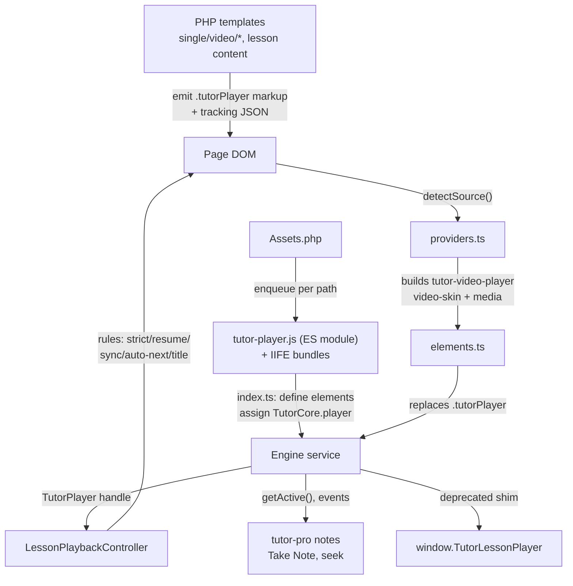
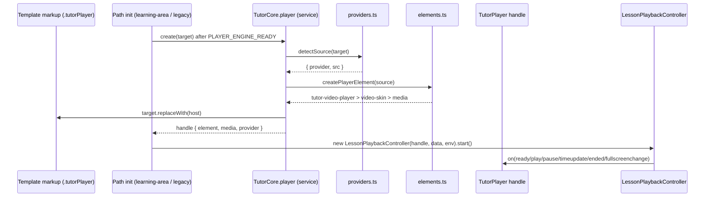
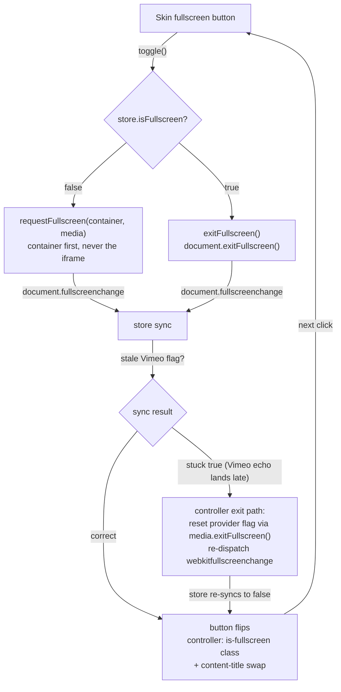
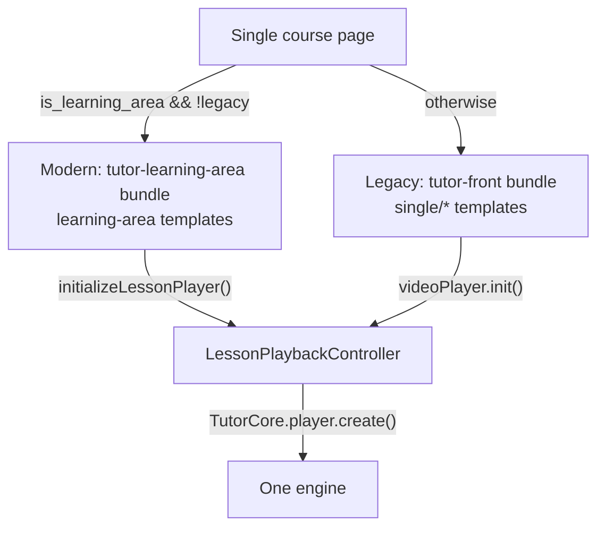

# Migration report: lesson playback from Plyr to Video.js 10

- **Status:** implemented on `feat/videojs-migration` (35 commits, 68 files, +5458/−2436 vs `4.2.0`); release/versioning out of scope.
- **Scope:** free plugin owns the engine; `tutor-pro` lesson notes migrated onto the new API; course-intro video included. `embedded`/`shortcode` sources and the native-iframe YouTube/Vimeo paths stay out of the engine by decision (Q3/Q4).
- **Design records:** `docs/plans/videojs-migration-plan.md`, `docs/adr/0001`–`0009`, `.scratch/videojs-migration/`.

## 1. Why migrate

Plyr was a vendored copy of 3.8.4 (`assets/lib/plyr/`). The reasons for replacing it (ADR-0001):

1. **YouTube branding leak.** Plyr fullscreened the YouTube iframe itself, so YouTube's own chrome appeared over lessons.
2. **Captions and scrub previews.** Needed more custom work on Plyr than the team wanted to keep maintaining; Video.js 10 ships them as capabilities.
3. **Supported path.** Video.js 8 is the legacy line and the official Plyr migration guide targets Video.js; 10 is the current release.
4. **Architecture fit.** Video.js 10 (`@videojs/html`) is framework-native: custom elements plus a reactive store. That maps cleanly onto a shared engine (`TutorCore.player`) with one typed handle for every caller — free plugin, Pro, present and future — instead of per-page Plyr glue.
5. **Native `<video>` only was rejected**: it loses a consistent skin across HTML5, external URL, YouTube, and Vimeo.

## 2. What changed

| Area                                                                            | Change                                                                                                                                                                                                            |
| ------------------------------------------------------------------------------- | ----------------------------------------------------------------------------------------------------------------------------------------------------------------------------------------------------------------- |
| Engine (new, `assets/core/ts/services/player/`)                                 | `index.ts` (ES-module entry), `PlayerService.ts`, `Player.ts` (handle), `elements.ts` (DOM builder + shadow patches), `providers.ts` (source detection), `legacy.ts` (deprecated `window.TutorLessonPlayer` shim) |
| Contract (new, `assets/core/ts/types/player.ts`)                                | `TutorPlayer`, `PlayerProvider`, `PlayerEvent`, `PlayerService`. Types only — safe for IIFE bundles                                                                                                               |
| Controller (rewritten, `assets/src/js/frontend/learning-area/lesson/player.ts`) | `LessonPlaybackController`: Strict Mode guard, completion button, Watch Progress Sync, Best Watch Time resume, auto-next, mobile Vimeo mute, fullscreen title swap + stuck-store resync                           |
| Paths wired                                                                     | Learning Area (`initializeLessonPlayer`), legacy + course intro (`tutor-front.js` via `TutorCore.player.create()`), dormant Alpine component                                                                      |
| PHP                                                                             | `Assets.php` drops `tutor-plyr`, enqueues `tutor-player.js` as `type="module"` (WP minimum is 5.3, so no `wp_enqueue_script_module`); `lesson_title` added to the tracking JSON in both lesson templates          |
| Styles                                                                          | `_videojs-player.scss` (host/skin/embed sizing, shared by the learning-area, dashboard, and legacy bundles); player radius forced to 0; Take Note top placement in fullscreen                                     |
| Pro (sibling repo)                                                              | Notes seek via `TutorCore.player`; Take Note button moves into the player in fullscreen; fullscreen Take Note moved to the top                                                                                    |
| Deleted                                                                         | `assets/lib/plyr/*`, Plyr types, Plyr SCSS, the ~250-line jQuery `videoPlayer`/`new Plyr` block                                                                                                                   |

## 3. Measured stats

Measured 2026-10-13 on this checkout. Sizes are built files on disk; gzip via `gzip -c`.

### 3.1 Bundle size (per lesson page)

| Payload                                      | Raw           | Gzip       | Notes                                                                                              |
| -------------------------------------------- | ------------- | ---------- | -------------------------------------------------------------------------------------------------- |
| Before: `plyr.polyfilled.min.js`             | 119,657 B     | 35,038 B   | enqueued on lesson pages                                                                           |
| Before: `plyr.css`                           | 32,455 B      | 5,179 B    | enqueued on lesson pages                                                                           |
| **Before total**                             | **152,112 B** | **~40 KB** |                                                                                                    |
| After: `tutor-player.js` (ES module)         | 560,603 B     | 124,290 B  | engine + skin; provider adapters are deferred                                                      |
| After: `lazy-chunks/tutor-player-vimeo.js`   | 96,694 B      | 27,815 B   | fetched only when a Vimeo lesson mounts                                                            |
| After: `lazy-chunks/tutor-player-youtube.js` | 34,716 B      | 11,326 B   | fetched only when a YouTube lesson mounts                                                          |
| After: player CSS                            | ~1 KB         | —          | `_videojs-player.scss` folds into the already-loaded `tutor-front` / `tutor-learning-area` bundles |

Per-lesson gzip and net delta vs Plyr:

| Lesson provider          | After gzip | Net delta     |
| ------------------------ | ---------- | ------------- |
| HTML5 / external / embed | 124,290 B  | +~82 KB gzip  |
| YouTube                  | 135,616 B  | +~93 KB gzip  |
| Vimeo                    | 152,105 B  | +~109 KB gzip |

The engine is still ~3–3.8× the old player over the wire; the skin and Video.js core are the remaining bulk (the Vimeo SDK alone accounts for most of the Vimeo-lesson delta). It is loaded only on single-course pages (`is_single_course(true)`), same gating as before.

### 3.2 Mount performance

Measured in desktop Chrome with the production `tutor-player.js`, mounting a public Vimeo embed via the real `TutorCore.player.create()` path, N=5:

| Metric                                          | Cold (first) | Warm (steady) |
| ----------------------------------------------- | ------------ | ------------- |
| `create()` — DOM build, provider detect, handle | 22.9 ms      | ~5.4 ms       |
| `create()` → `ready` event                      | 57.6 ms      | ~10 ms        |

First mount pays custom-element definition/upgrade; steady-state mounts are single-digit milliseconds plus the embed handshake.

### 3.3 Verification ladder

| Gate                                                                            | Result                                                                                                                            |
| ------------------------------------------------------------------------------- | --------------------------------------------------------------------------------------------------------------------------------- |
| Vitest unit                                                                     | 54 passed / 6 files (engine, handle, service, providers, compat, controller)                                                      |
| `tsc --noEmit`                                                                  | clean                                                                                                                             |
| `rspack --mode=production` (single invocation; player built as second compiler) | green                                                                                                                             |
| Cypress `lesson-video-player.cy.ts`                                             | authored (mount, ready, fullscreen payload, Strict Mode, resume, auto-next); not executed here — suite targets a remote `baseUrl` |
| `cdn.plyr.io` / vendored Plyr references at runtime                             | none remaining                                                                                                                    |
| ADR-0009 spike gate                                                             | `document.fullscreenElement` is the player container, never the iframe; no YouTube chrome in fullscreen                           |

## 4. Trade-offs

| Gain                                                                                                                                                        | Cost                                                                                                                                                                                                              |
| ----------------------------------------------------------------------------------------------------------------------------------------------------------- | ----------------------------------------------------------------------------------------------------------------------------------------------------------------------------------------------------------------- |
| Consistent skinned controls for every provider: captions, playback rate, quality/audio tracks, PiP, remote playback; unsupported controls hidden per-device | +~82 KB gzip JS on HTML5/external lessons, +~93 KB YouTube, +~109 KB Vimeo (§3.1)                                                                                                                                 |
| Container-first fullscreen for **all** providers — YouTube chrome is gone without vendoring the skin (ADR-0009)                                             | Vimeo's SDK relays container fullscreen into the embed and echoes back asynchronously; its flag could stick and brick the toggle — corrected at our layer with an exit-time flag reset + store re-sync (see §5.4) |
| One typed API (`TutorCore.player`) for free, Pro, and future callers; fake-able handle with full unit coverage                                              | ESM-only delivery: a second rspack config with `output.module`, a `script_loader_tag` filter, and a hard rule that no IIFE bundle may import the engine (ADR-0002)                                                |
| Lesson behaviours preserved: Strict Mode, resume, Watch Progress Sync, auto-next, mobile Vimeo mute, `is-fullscreen` class, `TutorLessonPlayer` compat shim | Hard cutover, no feature flag; rollback is re-enqueueing Plyr (engine is inert until `create()` is called)                                                                                                        |
| Skin title region repurposed: provider title suppressed, lesson title shown in fullscreen only                                                              | Browser floor regresses to roughly Chrome/Edge 111+, Safari/iOS 16.4+, Firefox 121+ (~91.5% of users); older browsers, most in-app webviews, and smart TVs lose full support — deliberate per ADR-0001            |
| Release ordering decoupled via the one-cycle `TutorLessonPlayer` adapter                                                                                    | Pro must still ship after free for the new affordances                                                                                                                                                            |

Deliberately **not** taken: vendored skin (ADR-0003 fallback), YouTube-only element without fullscreen (ADR-0008 fallback), caption/scrub-preview authoring (ADR-0006), note markers on the progress bar, `embedded`/`shortcode` in the engine.

## 5. How the migration works

### 5.1 Architecture

Two layers split along the ESM boundary (plan §Architecture): the engine owns Video.js and knows nothing about lessons; the controller owns lesson rules and knows nothing about Video.js internals — it only sees the `TutorPlayer` handle. Templates were intentionally left untouched (ADR-0004): the engine builds its DOM from the existing `.tutorPlayer` markup in JS.

### 5.2 Render → enqueue → boot

1. **Render.** The video templates (`single/video/vimeo.php`, `youtube.php`, `html5.php`, …) emit the legacy markup (`.plyr__video-embed.tutorPlayer` + iframe, kept as the detection hook). Both lesson templates (`learning-area/lesson/content.php`, `single/lesson/content.php`) emit the hidden `#tutor_video_tracking_information` JSON, now including `lesson_title`.
2. **Build/enqueue.** The IIFE entries and the ES-module player engine are built in a single `rspack --mode=production` invocation (two compilers) with the player's output chunked as ESM (`chunkFormat: "module"`) and its `clean` disabled. Legacy pages (`frontend_scripts()`) load `tutor-front` + the engine; learning-area pages (`enqueue_scripts()`) load `tutor-learning-area` + the engine. Engine JS goes out with `type="module"`.
3. **Boot.** The engine module imports the skin, defines `<tutor-video-player>`, assigns `window.TutorCore.player`, and dispatches `PLAYER_ENGINE_READY` (both IIFE bundles load before the deferred module, so they wait for it). The YouTube/Vimeo media adapters are _not_ imported eagerly: `elements.ts` `import()`s `lazy-chunks/tutor-player-{youtube,vimeo}.js` on first mount of that provider, then appends the media element.

### 5.3 Mount sequence (both paths)

The learning-area path mounts `.tutor-lesson-video-wrapper .tutorPlayer`; the legacy path mounts every `.tutorPlayer` (lessons + course intro) through a legacy environment adapter (`_tutorobject`/nonce/`tutor_toast`). Same controller class, different environment — that is what keeps Strict Mode, resume, sync, and auto-next identical in both modes.

### 5.4 Fullscreen flow (including the Vimeo fix)

Details:

- The skin fullscreens the **container**, so Tutor controls, captions, and Pro's in-fullscreen note UI survive; YouTube's chrome never appears (ADR-0009 gate).
- The skin's title region is repurposed: the engine defaults `content-title=""` (provider title never shows); the controller sets the **lesson** title on enter and clears it on exit.
- Vimeo's SDK relays container fullscreen into the embed and echoes back asynchronously, while the packaged store syncs synchronously trusting the provider flag — so after an exit the store could stick at `true` and the next toggle would misfire `exitFullscreen` (`Document not active`). The controller detects that exact state on exit (document out of fullscreen, store still claiming it), resets the stale provider flag through the media element's own `exitFullscreen()`, and re-runs the store sync via a synthetic `webkitfullscreenchange` — an alias our handler and Pro never listen to, so nothing double-fires.

### 5.5 Legacy vs modern at a glance

## 6. Verification status and follow-ups

- Done: unit/type/build gates (§3.3), Plyr removal, Pro migration, Take Note positioning, radius/aspect fixes, fullscreen title + toggle fixes, zips rebuilt (`tutor-4.1.1.zip`, `tutor-pro-4.1.1.zip`).
- Still human-gated: the manual provider matrix (Chrome, Firefox, Safari, iOS Safari × all providers, plan §Layer 3) and the final merge approval.
- After one release cycle: remove the deprecated `window.TutorLessonPlayer` adapter and `tutorLessonPlayerReady`.
- Note: `TUTOR_ENV` is `PROD` on test sites, so JS/CSS are version-pinned — hard-refresh lesson pages (or bump the version) when validating new bundles.
